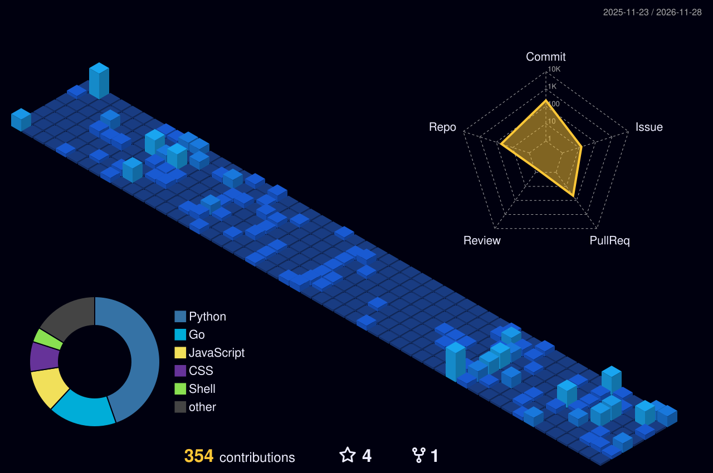

<!-- markdownlint-disable MD033 -->

<table width="100%">
  <tr>
    <td width="50%" align="center">
      
    </td>
    <td width="50%" align="center">
      <h3>Connect :)</h3>
      
      &nbsp;
      
    </td>
  </tr>
</table>

## About

Focused on open source infrastructure and cloud-native tooling. Currently an LFX Mentee (2026 Term 1) on Karmada, working closer to Kubernetes multi-cluster orchestration than typical application CRUD.

I enjoy problems where systems behavior, reliability, and clear abstractions matter. Day to day that means Go, Kubernetes, and practical tooling — while still shipping web interfaces with React when the product needs it.

 

## Technical Stack

| I have | I'm learning |
| :---: | :---: |
|  |  |

 

## Projects

<table align="center" width="100%">
  <tr>
    <td width="50%" valign="top">
      <h3>
        <a href="https://github.com/Krishiv-Mahajan/LogMorph">LogMorph</a>
      </h3>
      
Adaptive log processing and normalization platform that detects schema drift, automatically adapts to log format changes, and uses AI-assisted escalation for unknown formats.

      

        
        
      

    </td>
    <td width="50%" valign="top">
      <h3>
        <a href="https://github.com/Krishiv-Mahajan/Payment-Recovery-Opportunity-Engine">Payment Recovery Engine</a>
      </h3>
      
AI-powered payment recovery system that identifies failed-payment opportunities, predicts recovery likelihood, selects the right action, and executes bounded recovery workflows.

      

        
        
      

    </td>
  </tr>
  <tr>
    <td width="50%" valign="top">
      <h3>
        <a href="https://github.com/Krishiv-Mahajan/Revenue-degradation-recovery">Revenue Degradation Recovery</a>
      </h3>
      
Tooling around revenue degradation signals — detecting drops early and supporting practical remediation paths for recovery-focused workflows.

      

        
      

    </td>
    <td width="50%" valign="top">
      <h3>
        <a href="https://github.com/Krishiv-Mahajan/Frontend_assignments">Frontend Assignments</a>
      </h3>
      
Hands-on frontend practice building responsive interfaces and component-based React patterns with a focus on shipping clean UI.

      

        
        
      

    </td>
  </tr>
</table>

 

## Activity

<table width="100%">
  <tr>
    <td align="center">
      
    </td>
  </tr>

</table>

 

## Engineering Direction

- **Open Source:** LFX Mentee (2026 Term 1) on Karmada; contributing to cloud-native multi-cluster projects.
- **Cloud Native:** Exploring Kubernetes, workload orchestration, and reliable distributed systems tooling.
- **Language Focus:** Writing Go for cloud-native work and JavaScript/React when building product interfaces.
- **Goal:** Grow into systems engineering through real open source contributions and shipped tooling.

 
