<!-- markdownlint-disable MD033 -->

<table width="100%">
  <tr>
    <td width="30%" align="center">
      
    </td>
    <td width="25%" align="center">
      <h3>Connect :)</h3>
      
      &nbsp;
      
      &nbsp;
      
    </td>
    <td width="45%" align="center">
      
    </td>
  </tr>
</table>

 

## About

Computer Science student from Pune focused on shipping useful web products, sharpening problem-solving skills, and growing through open source.

I build frontend-first apps with React and modern JavaScript, practice DSA daily in Java, and keep expanding into systems and DevOps with Docker, Go, Linux, and Python. The goal is simple: ship useful things, then improve them fast.

 

## Technical Stack

| I have | I'm learning |
| :---: | :---: |
|  |  |

 

## Projects

<table align="center" width="100%">
  <tr>
    <td width="50%" valign="top">
      <h3>
        <a href="https://github.com/Krishiv-Mahajan/LogMorph">LogMorph</a>
      </h3>
      
Adaptive log processing and normalization platform that detects schema drift, adapts to format changes, and uses AI-assisted escalation for unknown formats.

      

        
        
      

    </td>
    <td width="50%" valign="top">
      <h3>
        <a href="https://github.com/Krishiv-Mahajan/Payment-Recovery-Opportunity-Engine">Payment Recovery Engine</a>
      </h3>
      
AI-powered system that finds failed-payment recovery opportunities, predicts success likelihood, picks the right action, and runs bounded recovery workflows.

      

        
        
      

    </td>
  </tr>
  <tr>
    <td width="50%" valign="top">
      <h3>
        <a href="https://github.com/Krishiv-Mahajan/Revenue-degradation-recovery">Revenue Degradation Recovery</a>
      </h3>
      
Recovery-focused tooling around revenue degradation signals — detecting drops early and supporting practical remediation paths.

      

        
      

    </td>
    <td width="50%" valign="top">
      <h3>
        <a href="https://github.com/Krishiv-Mahajan/Frontend_assignments">Frontend Assignments</a>
      </h3>
      
Hands-on frontend practice: responsive interfaces, component-based React patterns, and shipping clean UI beyond demos.

      

        
        
      

    </td>
  </tr>
</table>

 

## Activity

<table width="100%">
  <tr>
    <td align="center">
      
    </td>
  </tr>
  <tr>
    <td align="center">
      
    </td>
  </tr>
</table>

 

## Engineering Direction

- **Web Products:** Shipping responsive, modern interfaces with clean React code.
- **Problem Solving:** Practicing DSA consistently in Java and applying it to real builds.
- **Systems & DevOps:** Leveling up with Docker, Go, Linux, and Python.
- **Open Source:** Looking to collaborate on practical projects and grow through contributions.

 

